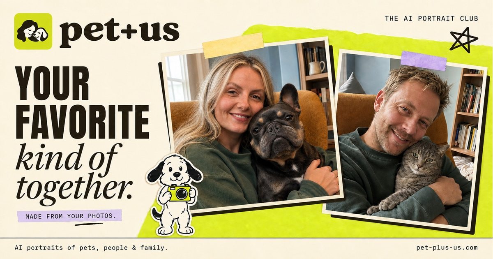

# Pet Plus Us

  

  <strong>AI portraits of pets, people, and the whole family</strong>

  
  

Turn everyday photos of your people and pets into an AI portrait worth keeping. Free to preview, yours to keep.

## Links

| | URL |
|---|---|
| **App** | https://www.pet-plus-us.run |
| **This landing** | https://xianyu110.github.io/pet-plus-us/ |

## Pricing

First portrait from $19 · Extra $10 · Packs $39 / $99

Exact price shown on-site before you pay.

## Disclaimer

Independent AI portrait tool. Use only photos you have rights to. Label AI-generated content when you share.

Official product domain only: **https://www.pet-plus-us.run**
